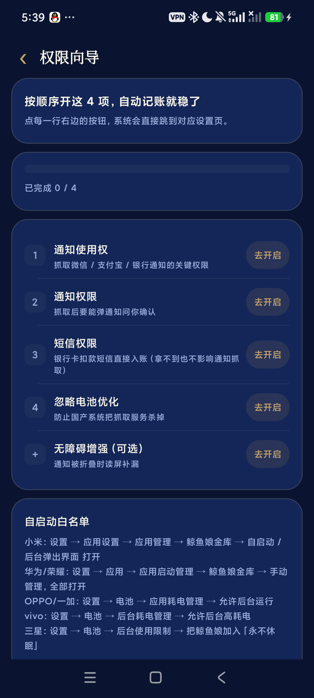
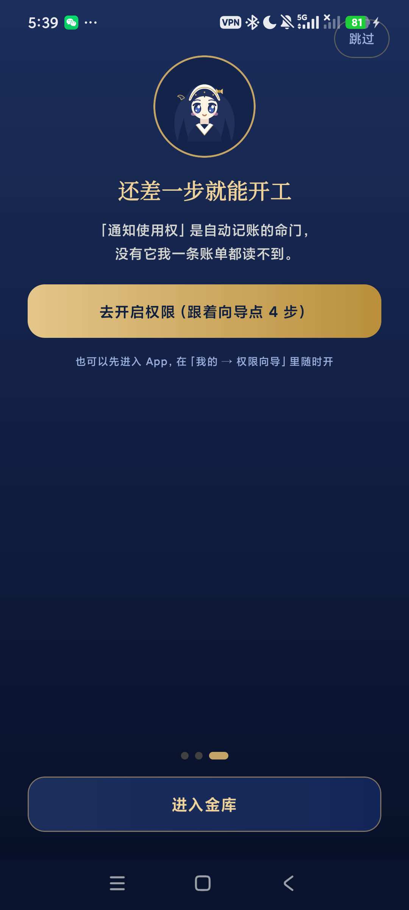

# 鲸鱼娘金库 · 安装与使用说明（发给使用者看的那一份）

> 一页看完就能用：怎么装 → 开哪 3 个权限 → 怎么确认它真的在记账 → 出问题怎么办。

---

## 一、你的手机能装吗

| 要求 | 说明 |
|---|---|
| 系统 | **Android 8.0 及以上**（2017 年后的手机基本都满足） |
| 芯片 | **64 位 ARM（arm64-v8a）** —— 装包只打了 arm64，**32 位老机型装不上**（会提示「应用未安装/不兼容」） |
| 空间 | 约 25 MB（安装后约 60 MB） |
| 不需要 | root、不需要登录账号、不需要联网也能记账（AI 功能才需要联网 + 自备 Key） |

> iPhone / 平板（iPad）装不了，这是安卓原生 App。
> 装之前请确认你手上是**正式安装包**：`鲸鱼娘金库-v1.2.0.apk`，用随包的 `SHA256SUMS.txt` 里的值校验一下更稳。

---

## 二、安装（3 步）

1. **把 APK 传到手机**：数据线拷贝、微信/QQ 发文件、网盘下载都行；建议先存到「文件管理 → 下载」里再点。
2. **点开 APK** → 系统提示「禁止安装未知来源应用」时，点「设置」→ 允许该来源安装（只需一次）。
3. **点「安装」** → 完成后桌面出现「鲸鱼娘金库」鲸鱼图标。

> 小米/红米（HyperOS/MIUI）可能额外提示「应用来源未知，是否继续」→ 点继续；
> 部分机型会扫毒，等它扫完再点安装。
> ⚠️ 用 `adb install` 给别人装机时，MIUI 会弹「USB 安装管理」并可能拦住**新包**（不是包坏了，是系统的安全限制），这种情况下让对方自己在手机上点安装。

---

## 三、首次打开：跟着做 3 步（约 1 分钟）

第一次打开有三页引导，**第 3 页点「去开启权限」，会带你到「权限向导」**——这是整个 App 最关键的一步。

### 权限向导要开的 4 项

| 顺序 | 权限 | 为什么 | 必须吗 |
|---|---|---|---|
| 1 | **通知使用权** | 微信/支付宝付完会弹「支付成功」，只有它能读到这条通知 | **必须**，没有它一条账都抓不到 |
| 2 | **通知权限** | 抓到不确定的账要弹通知问你「确认入账/忽略」 | **必须** |
| 3 | **短信权限** | 银行卡扣款短信几乎 100% 能记上 | 强烈建议（不给也不影响通知抓取） |
| 4 | **忽略电池优化** | 防止国产系统把后台抓取服务杀掉 | **必须** |

**可选**：无障碍增强（通知被折叠时读屏补漏，部分机型会被系统回收，重开即可）。日常不必开。

### 还要设一次「自启动」（国产 ROM 必做）

权限向导页底部写了各厂商路径，照着点一遍：

- **小米/红米**：设置 → 应用设置 → 应用管理 → 鲸鱼娘金库 → **自启动** 打开、**后台弹出界面** 打开
- **华为/荣耀**：设置 → 应用 → 应用启动管理 → 鲸鱼娘金库 → 改成**手动管理**，四项全开
- **OPPO/一加**：设置 → 电池 → 应用耗电管理 → 允许**后台运行**
- **vivo**：设置 → 电池 → 后台耗电管理 → 允许**后台高耗电**
- **三星**：设置 → 电池 → 后台使用限制 → 把鲸鱼娘加入「**永不休眠**」

> 不设也能用，但手机锁屏久了容易被杀后台 → 表现为「有时候抓不到」。

---

## 四、确认它真的在记账（30 秒自测）

**A. 真付一笔试试**
用微信/支付宝付 **0.01 元** → 通知栏应弹出「🐳 抓到一笔支出」，点「确认入账」；打开 App 首页能看到这笔。

**B. 用 App 自带的抓取自测（不用真花钱）**
「我的 → 自动记账 → 抓取自测」有 3 个样例（微信/银行短信/支付宝），点一下就会走完整流水线，几秒后告诉你「已自动入账」或「已进待确认」。
三个都出结果 = 抓取链路正常。

---

## 五、日常怎么用

| 场景 | 怎么做 |
|---|---|
| 自动记账 | 什么都不用做，付完钱等它抓。抓到低置信度的会问你一句 |
| 手动记一笔 | 底部中间 **＋** → 数字键盘 → 选分类/账户 → 保存（有「午饭 25」这类**一键模板**） |
| 一句话记账 | 首页「跟鲸鱼娘说一句」→ 说/打「午饭 25 微信」→ 直接落账 |
| 问账 | 首页「问账」→ 「这个月餐饮花了多少」；没配 AI Key 也能回答基础问题 |
| 余额准不准 | 「我的 → 账户管理」顶部「**更新余额**」：手动输入或**截图识别**（会自动认出是微信还是支付宝），差额记成「余额调整」流水，**不算进本月收支** |
| 补历史账单 | 「我的 → 数据导入导出」→ 导入微信/支付宝官方导出的账单（csv/zip，加密的 zip 先在电脑解开） |
| 换手机 / 防丢 | 「我的 → 数据导入导出 → **创建加密备份**」→ 生成 `.whalebk` → 点「**另存到文件 / 云盘**」（或「分享这个文件」发到微信/网盘）。**密码忘了文件就打不开**，务必记牢 |
| 待确认太多 | 「我的 → 自动记账」待确认区右上角有「**全部忽略**」，一次清空（已入账的账目不受影响） |

**AI 功能说明**（可选）：「我的 → AI 设置」填一个 **OpenAI 兼容** 接口的 Key 才能用 AI 分类、AI 一句话记账、AI 月报。
默认填的是 DeepSeek 官方；想换 Kimi / 智谱 / 通义 / OpenRouter，甚至本机的 Ollama，只要把「接口地址」改成对应地址、模型名填对即可。
- 不填也能用：所有识别退回**本地规则**，完全离线
- Key 只存本机，请求直连 `api.deepseek.com`，App 没有自己的服务器
- 不想用了随时在「AI 设置」里关掉「启用 AI 能力」，关掉后不产生任何请求

---

## 六、常见问题

**Q：付了钱但没抓到？**
1. 检查「权限向导」第 1 项「通知使用权」是否还开着（系统升级/清理软件有时会关掉）；
2. 微信/支付宝的**通知是否被折叠或静音**（折叠的通知可能读不到）；
3. 后台被杀了 → 回来自启动设置；
4. 兜底办法：「数据导入导出」导入一次当日账单，漏的会补齐（会自动去重）。

**Q：刷抖音 / 逛淘宝时也会冒出待确认？**
v1.2.2 之后不会了：抖音/快手/小红书这类**内容 App 默认不抓**（只有像「支付成功 ¥12.90」这种才算），
淘宝/京东/拼多多的营销推送也拦掉了。如果还遇到，点那条右边的 🚫 → 「屏蔽整个 App」即可永久不抓，
之后在「自动记账 → 已屏蔽的来源」里随时恢复。

**Q：还信用卡算支出吗？**
不算。还款是「储蓄卡 → 信用卡」的**资金转移**，App 会把它记成**转账**：不进本月支出，但明细里能看到这笔。
如果还没建信用卡账户，这类通知会被跳过（「我的 → 账户管理 → 新增」里加一个类型为「信用卡」的账户即可）。

**Q：分类记错了，或者老是「其他」？**
v1.4.2 起不再用「其他」兜底了：认不出来的账会明确标成 **「待分类」**（❓ 图标），统计里也单列一栏。
去明细里点开那一条、把分类改对 —— **改一次它就记住了**，以后同一家商户自动归类。

关键词命中不了的长尾商户（比如「张记饼铺」），填了 AI Key 的话会由模型猜一次；
猜不出也不影响记账，只是先躺在「待分类」里等你。

**Q：老是抓错 / 老是漏抓怎么办？**
先试「我的 → 数据导入导出 → **说人话的规则**」：不用看 JSON，用大白话搜一下症状
（比如打「淘宝」「账单」「退款」「双记」），它会告诉你要动哪张表、该加哪几个词，
点「加入」就**立即生效**，不用等更新。

想自己塞一个词也行，同一个卡片底部有「自己加一个词」——记得词写长一点、具体一点，
单个字词根容易误伤真账。

要更细的控制，可以「导出规则」（一个 JSON），在对应词表里加/删词再导回来；
改坏了也不怕：文件不合格会自动回退到内置规则。

**Q：退款要记成收入吗？**
不用。抓到退款时，App 会自动去找 30 天内同金额的支出，并在待确认里提示「疑似 #123 的退款」，
旁边有个「冲销原账」按钮：点一下就把原来那笔支出冲掉，**不会虚增收入**。
不点也可以当普通收入记。

**Q：升级 App 会丢数据吗？**
不会，而且现在有多重保险：
① 每次升级后、以及每天第一次打开 App，会自动存一份「快照」（保留最近 7 份）；
② 升级要改数据库结构之前，会先把整个数据库文件复制一份，万一升级失败还能压回来；
③ 「数据导入导出 → 加密备份」导出的 .whalebk 可以存网盘/电脑，换手机用这个。
（自动快照只存在 App 私有目录，卸载 App 会一起消失，所以重要数据仍建议定期导一份加密备份。）

**Q：会不会记重复？**
短时间内的同金额同来源会判为重复并跳过；真重复了在明细里长按删除即可。

**Q：余额和微信里对不上？**
用「账户管理 → 更新余额」输一次真实金额，它会把差额记成一条「余额调整」，之后就从正确起点算。

**Q：待确认里堆了一堆不该记的（银行推送、账单提醒）怎么办？**
1.2.1 之后这类基本会被自动拦掉：账单提醒/额度调整/营销推送（含通知渠道过滤）、以及「一屏多笔金额」的账单列表页都不会再进待确认。
如果还有残留：待确认区右上角「**全部忽略**」一次清空；想彻底不抓某个来源，可以去「自动记账 → 抓错了/漏抓了？告诉管家」贴原文生成一条专属规则。

**Q：换手机数据怎么办？**
旧机「创建加密备份」→ 点「**另存到文件 / 云盘**」（或分享到微信/网盘）→ 新机装好 App → 「从备份恢复」选那个 `.whalebk` → 输入同一个密码。**没做备份就卸载，账本会一起没**（纯本地存储，没有云端）。

**Q：App 要联网吗？会偷数据吗？**
记账、抓取、解析全在手机本地完成，**没有任何服务器**；数据库在 App 私有目录，其他 App 读不到。只有你主动用 AI 功能时才会发请求到你配置的那个 AI 接口。

**Q：能上架应用商店 / 打包卖吗？**
不能。立绘素材是 CC BY-NC-SA 4.0（署名：上善 → ZipZipPipe → 深海女仆工坊 Small-tailqwq）+ 原作者存档图，**仅限个人非商业使用**，不可上架分发或商用。转发给朋友自用可以，请保留 App「关于」页里的署名。

---

## 七、卸载 / 升级

- **升级**：直接装新版本 APK 覆盖安装，**数据保留**（同一签名、版本号更高）。装完记得检查权限是否还在（个别系统会重置）。
- **卸载**：会删除全部账目和设置。卸载前先做一次「创建加密备份」。

---

> 遇到这里没写的问题，把现象（哪个 App 的通知没抓到 / 哪一步报错）记下来反馈给发布者。
